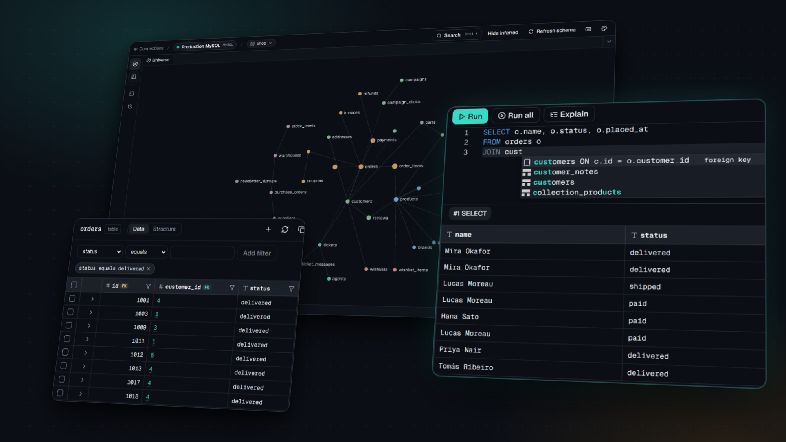

<picture>
  <source media="(prefers-color-scheme: dark)" srcset="docs/images/dbzuper-logo-dark.svg">
  
</picture>

# DBZuper

**One Workspace. Every Database.** A self-hosted, visual database workspace for MySQL, MariaDB, PostgreSQL and SQLite.

- **Schema Universe**: your schema as a zoomable graph of tables, relationships (declared and inferred) and clusters, with path finding and JOIN generation.
- **SQL workspace**: Monaco editor with schema-aware autocompletion, tabs per connection, explain, confirm-before-write safety, read-only connections and query history.
- **Data explorer**: server-side filters, sorting and paging per table, plus a record explorer that follows a row through its relationships.
- **Server-level connections**: leave the database empty to browse every database on a server and switch between them.
- **Dark by default**: ink and paper themes (dark, light or system), keyboard-first with a command palette, and an automated accessibility gate.
- **Self-hosted**: one Docker image, no external services at runtime, credentials encrypted at rest.

## Quick start

    docker run -d --name dbzuper -p 8080:8080 \
      --add-host=host.docker.internal:host-gateway \
      -v dbzuper-storage:/app/storage -v dbzuper-sqlite:/data/sqlite \
      ghcr.io/dbzuper/dbzuper:latest

    docker logs dbzuper 2>&1 | grep "setup code"

1. Open <http://localhost:8080> and enter the **setup code** from the log, then create your administrator account.
   Another port? Use for example `-p 3000:8080 -e DBZUPER_PORT=3000` and open port 3000
   ([more](docs/self-hosting.md#choosing-the-port)).
2. Click **Try it with demo data** to explore a sample database, or add a connection to your own.

To build the image from source instead: `git clone https://github.com/dbzuper/dbzuper && cd dbzuper && docker compose up -d --build --wait`,
then read the code with `docker compose logs app`.

## Connect your first database

Add a connection with the host, port and credentials of your MySQL, MariaDB or PostgreSQL server, or the path of a
SQLite file. Leave **Database** empty to browse every database on the server.

- **A database on the same computer:** inside Docker, `localhost` is the DBZuper container itself. Use
  `host.docker.internal` as the host instead.
- **SQLite files:** they must sit in an allowed directory, `/data/sqlite` in the image. See
  [Adding SQLite files](docs/self-hosting.md#adding-sqlite-files).
- **Read-only:** tick it to have the database itself refuse writes on that connection.

## Documentation

- [Self-hosting](docs/self-hosting.md): Docker, HTTPS behind a reverse proxy, backups and the `APP_KEY`, upgrades,
  environment reference, troubleshooting and security notes.
- [User guide](docs/user-guide.md): the Schema Universe, SQL workspace, data and record explorer, demo data.
- [Developing DBZuper](docs/development.md): local setup, tests and checks, releases, performance budgets.
- [Changelog](CHANGELOG.md): what changed, and what to do when upgrading.

## License

DBZuper is open source under the [MIT license](LICENSE). The DBZuper name and logo are not covered by it: see
[TRADEMARKS.md](TRADEMARKS.md) before publishing a fork.
